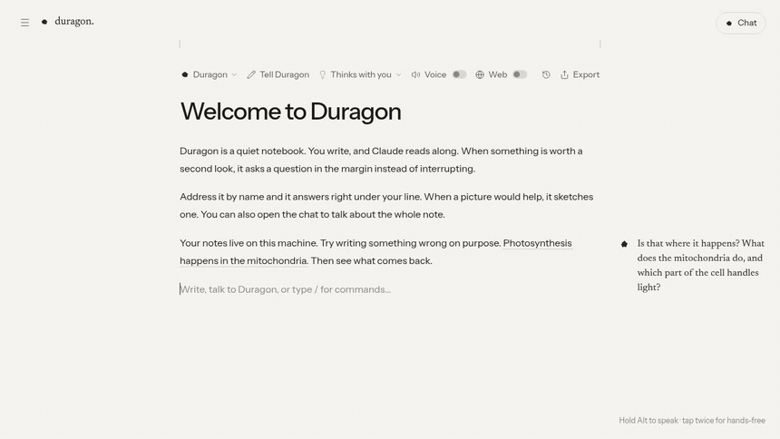
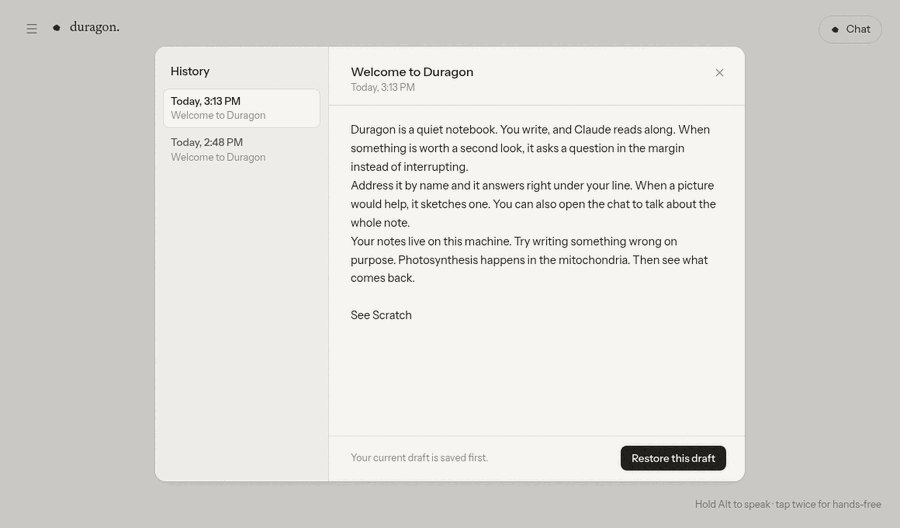

# Duragon

A quiet, local-first notebook where an AI mind reads along. Based on [Riddled](https://www.riddled.ai/).

You write; it asks questions in the margin when something deserves a second look, answers right under any line that starts with `Duragon,`, and sketches diagrams when a picture helps. It runs with local CLIs (`claude`, `agy`, `codex`), HTTP APIs (Anthropic, OpenAI, Gemini, OpenRouter, custom OpenAI-compatible), or local models (Ollama / llama.cpp), stores notes in a local SQLite database, and runs voice fully offline.

Tauri 2 + Rust backend, Svelte 5 + TipTap frontend. Design notes live in `docs/`.

---

## How it works

### Margin questions & inline sketches

With **Thinks with you** on, Duragon reads each paragraph after you pause and speaks up in the margin only when it matters. Address it directly (`Duragon, …`) for an inline answer or a step-by-step sketch right under your line.



### Note-to-note `[[links]]`, backlinks & in-note find

Type `[[` to link another note inline. Linked notes display a quiet **Mentioned in** footer, and when cross-note search is enabled in chat, the AI receives a compact index of linked titles and reads them on demand. Press `Ctrl+F` (or `/` in Vim mode) to search inside the current note.


### Revision history, providers & keyboard / Vim mode

Browse automatic per-note snapshots from the History icon and restore any earlier draft (your current draft is saved first). Configure models, thinking effort, web search providers, custom shortcuts, and optional Vim mode in **Customize**.



---

## Features

- **Margin reading & side chat:** Toggle per-note between *Thinks with you* and *When you ask*, open side chat (`Ctrl+J`), or select any text for formatting, *Riddle this* (`Ctrl+Enter`), *Ask Duragon*, or *Visualize*.
- **Multiple AI backends:** Choose models and thinking effort per job (Reading, Chat, Drawing) across Claude CLI, Antigravity CLI, Codex CLI, HTTP APIs, or local Ollama / llama.cpp servers.
- **Configurable web search & `web_fetch`:** Configure Tavily, Brave Search, Exa, Firecrawl, or Ollama search with SSRF-protected page fetching; when no search provider is configured, CLI runners fall back to their built-in web search.
- **Note-to-note `[[links]]` & backlinks:** Inline note linking with automatic backlinks and token-efficient on-demand AI context.
- **Per-note revision history:** Automatic throttled snapshots in SQLite with preview and reversible restore.
- **Markdown import & export:** Export a single note (Markdown, Word, PDF), export a folder from the sidebar, or import Markdown files and export the full notebook from Settings.
- **Customizable keybindings & Vim mode:** Rebind any shortcut or enable Duragon-tailored Vim mode (`hjkl`, `w`/`b`/`e`, `dd`/`cc`/`yy`, `p`/`P`, `/`, `n`/`N`, and `g` chords) in **Customize → Keyboard**.
- **Custom Minds:** Create custom reviewers (Staff engineer, Editor, Skeptic, …) in **Customize → Minds**.
- **Offline voice:** Local speech recognition (NVIDIA Parakeet TDT 0.6B v2) and speech synthesis (Kokoro) on CPU. Hold `Alt` to talk or tap `Alt` twice for hands-free.

---

## Requirements

- Nix with flakes (provides Rust, `cargo-tauri`, Node, WebKitGTK, and audio libraries).
- At least one AI backend: a logged-in CLI (`claude`, `agy`, or `codex` on your `PATH`), an HTTP API key in **Customize → Providers**, or a local Ollama / OpenAI-compatible server.

## Run it

First time:

```sh
nix develop
npm install
```

Day to day:

```sh
nix develop -c cargo tauri dev
```

Build a standalone binary without the dev server:

```sh
nix develop -c cargo tauri build --no-bundle
./target/release/duragon
```

Notes are stored in `~/.local/share/dev.duragon.app/duragon.db` (voice models in `models/` next to it). Set `XDG_DATA_HOME` to store data elsewhere.

## Develop

```sh
npm run dev                                # UI only, in a browser, against an in-memory mock backend
npm run check                              # svelte-check
npm run build                              # production frontend bundle
nix develop -c cargo test --workspace      # Rust tests (no models or network needed)
nix develop -c cargo clippy --workspace --all-targets -- -D warnings
```

`scripts/e2e/` drives the real desktop window through `tauri-driver` and makes real `claude` calls; see its README. `cargo test -p duragon-voice --test real_models -- --ignored` downloads the voice models and checks a speak-then-transcribe round trip.

## License

MIT — see [LICENSE](LICENSE).
