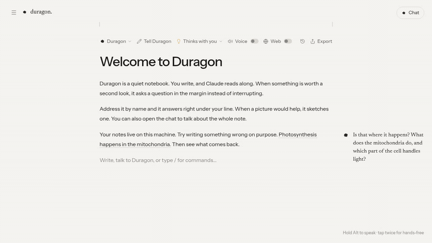

# Duragon

A quiet, local-first notebook where an AI mind reads along. Based on [Riddled](https://www.riddled.ai/).

Write in a calm, distraction-free page: Duragon reads along in the background, asks questions in the margin when something deserves a second look, answers inline when addressed by name (`Duragon, …`), and sketches step-by-step diagrams when a picture explains faster than prose. Everything stays on your machine in SQLite, works with local CLIs, HTTP APIs, or local models, and runs voice fully offline.

> **Stack:** Tauri 2 + Rust (`duragon-core`, `duragon-voice`), Svelte 5 + TipTap, SQLite.
> **Documentation:** Browse the **[Wiki](docs/wiki/Home.md)** for full guides on [Providers & Web Search](docs/wiki/Providers-and-Web-Search.md), [Editor, Links & History](docs/wiki/Editor-Links-and-History.md), [Keyboard & Vim](docs/wiki/Keyboard-and-Vim.md), [Minds & Reading](docs/wiki/Minds-and-Reading.md), [Offline Voice](docs/wiki/Voice.md), and [Architecture](docs/wiki/Architecture-and-Components.md).

---

## See it in action

### Margin questions & step-by-step sketches

With **Thinks with you** enabled, Duragon reads each paragraph after you pause and surfaces questions in the margin without interrupting. Address it directly (`Duragon, …`) for an inline answer or a hand-drawn diagram right under your line.


### Note-to-note `[[links]]`, backlinks & in-note find

Type `[[` to link another note inline. Linked notes display a quiet **Mentioned in** backlinks footer, and when cross-note search is enabled in chat, the AI receives a compact index of linked titles and reads them on demand. Press `Ctrl+F` (or `/` in Vim mode) to search inside the current note.



### Revision history, providers & keyboard / Vim mode

Browse automatic per-note snapshots from the History icon and restore any earlier draft safely (your current draft is saved first). Configure models, thinking effort, web search providers, custom keybindings, and optional Vim mode in **Customize**.


---

## Highlights

| Area | What Duragon does | Guide |
| :--- | :--- | :--- |
| **Minds & Reading** | Margin questions, inline answers (`Duragon, …`), side chat (`Ctrl+J`), per-note briefs (*Tell Duragon*), and custom Minds | [Minds & Reading](docs/wiki/Minds-and-Reading.md) |
| **Providers & Web** | Per-job model & thinking effort across Claude CLI, Antigravity CLI, Codex CLI, HTTP APIs, and Ollama / llama.cpp; optional Tavily/Brave/Exa/Firecrawl/Ollama search + SSRF-safe `web_fetch` | [Providers & Web Search](docs/wiki/Providers-and-Web-Search.md) |
| **Editor & Notes** | Rich text, KaTeX math, highlighted code blocks, `[[links]]` + indexed backlinks, in-note find, revision history, and Markdown import/export | [Editor, Links & History](docs/wiki/Editor-Links-and-History.md) |
| **Keyboard & Vim** | Rebindable shortcuts and optional Duragon-tailored Vim mode (`hjkl`, `w`/`b`/`e`, `dd`/`cc`/`yy`, `p`/`P`, `/`, `n`/`N`, `g` chords) | [Keyboard & Vim](docs/wiki/Keyboard-and-Vim.md) |
| **Offline Voice** | Local CPU speech-to-text (NVIDIA Parakeet TDT 0.6B v2 / Whisper) and text-to-speech (Kokoro / speech-dispatcher) | [Offline Voice](docs/wiki/Voice.md) |
| **Architecture** | Local-first SQLite storage, privacy masking (`Veil`), atomic transactions, and modular Rust/Svelte layout | [Architecture](docs/wiki/Architecture-and-Components.md) |

---

## Quick start

### Requirements

- **Nix with flakes** (the dev shell provides Rust, `cargo-tauri`, Node, WebKitGTK, and audio libraries).
- **At least one AI backend:**
  - a logged-in CLI on your `PATH` (`claude`, `agy`, or `codex`),
  - an HTTP API key configured in **Customize → Providers**, or
  - a local Ollama / llama.cpp OpenAI-compatible server.

### Run in development

```sh
nix develop
npm install
nix develop -c cargo tauri dev
```

### Build a standalone binary

```sh
nix develop -c cargo tauri build --no-bundle
./target/release/duragon
```

Notes live in `~/.local/share/dev.duragon.app/duragon.db` (voice models in `models/` next to it). Set `XDG_DATA_HOME` to store data elsewhere.

---

## Development & checks

```sh
npm run dev                                # UI only, in a browser, against an in-memory mock backend
npm run check                              # svelte-check
npm run build                              # production frontend bundle
nix develop -c cargo test --workspace      # Rust unit & integration tests (offline)
nix develop -c cargo clippy --workspace --all-targets -- -D warnings
```

- `scripts/e2e/` drives the real desktop window via `tauri-driver` with real CLI calls (see `scripts/e2e/README.md`).
- `cargo test -p duragon-voice --test real_models -- --ignored` downloads the voice models and tests a speak-then-transcribe round trip.

## License

MIT — see [LICENSE](LICENSE).
