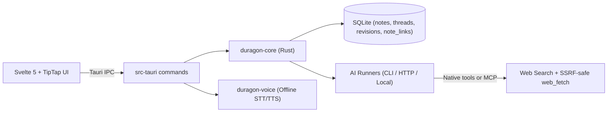

# Duragon Wiki

Welcome to the Duragon documentation. Each page covers one part of the application in detail.

## Pages

- **[Providers & Web Search](Providers-and-Web-Search.md)** — AI backends (CLIs, HTTP APIs, local servers), per-job models and thinking effort, configurable web search engines, SSRF-safe `web_fetch`, MCP vs native tool calling, and credential/privacy handling.
- **[Minds & Reading](Minds-and-Reading.md)** — Margin questions, inline answers, sketches, side chat, reading modes, custom Minds, per-note briefs (*Tell Duragon*), and *About you*.
- **[Editor, Links & History](Editor-Links-and-History.md)** — TipTap blocks (math, code, slash commands), note-to-note `[[links]]`, indexed backlinks, on-demand AI context, in-note find, per-note revision history, and Markdown import/export.
- **[Keyboard & Vim](Keyboard-and-Vim.md)** — Default shortcuts, custom keybinding remapping, and Duragon-tailored Vim mode.
- **[Offline Voice](Voice.md)** — Local speech-to-text (Parakeet / Whisper), local text-to-speech (Kokoro / speech-dispatcher), push-to-talk, hands-free mode, and model storage.
- **[Architecture & Components](Architecture-and-Components.md)** — Codebase layout across Rust and Svelte, SQLite schema, IPC boundaries, and security/privacy model.

## High-level overview

